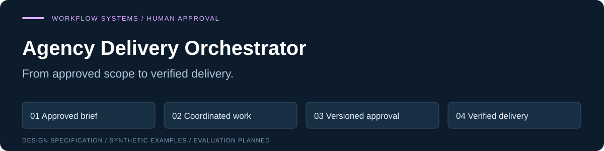
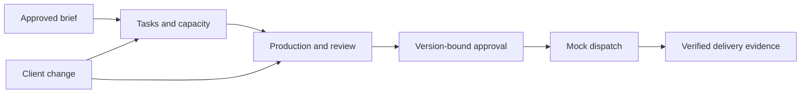

# Agency Delivery Orchestrator



[](https://github.com/vishwanathmuthuraman/agency-delivery-orchestrator/actions/workflows/docs.yml)

**How can a campaign stay coordinated when its inputs, deadlines or approved content change?**

Model the full campaign lifecycle: scope, task ownership, capacity, review, change handling, delivery verification and billing evidence.

**Stage: research specification.** This repository contains design work and synthetic examples. Application implementation and performance evaluation are pending; there is no working product or measured result yet.

[Explore the example](#a-concrete-example) · [Architecture](docs/02-architecture.md) · [Evaluation protocol](docs/04-evaluation.md) · [Engineering standards](ENGINEERING.md)

## A concrete example

A client changes an approved product claim. The script, caption and scheduled post depend on that claim. Updating one text field does not establish that the video was edited or that the correct version was delivered.

[Six synthetic workflow scenarios](examples/README.md)

The expected outcomes describe the intended behavior. They are not output from an executed application.

## How the proposed system works



Sending a request is not completing the work. The system must reconcile uncertain outcomes and bind approvals to the actual version being delivered.

## What you can inspect today

| Artifact | What it establishes |
|---|---|
| Requirements and architecture | The proposed problem, boundaries and consequential design decisions. |
| Original synthetic scenarios and schemas | Concrete inputs and explicit expected behavior. |
| Evaluation protocol and release criteria | How implementation and claims should be assessed. |
| Source rationale | Which public evidence motivated the design and which conclusions remain hypotheses. |
| Documentation checks | Whether the supplied JSON, relative links and original SVG assets are structurally valid. |

Six original synthetic scenarios with expected outcomes, contracts, lifecycle requirements, architecture and a proposed comparative evaluation.

## Technical choices

Python + SQLite for the offline workflow simulator. Production connectors and a user interface follow separate justified architecture decisions; v1 external actions remain mocked.

Python, Go, Rust, SQL, TypeScript and Rails each have appropriate uses. This project follows [documented selection rules](ENGINEERING.md): add a runtime or framework only when requirements, profiling and maintainability justify it.

## What the evaluation must show

Measure correct impact handling, approval validity, completion evidence, unnecessary blocking and unresolved dispatch outcomes. Keep mock delivery, human editing and optional model proposals distinct.

The [evaluation protocol](docs/04-evaluation.md) defines the comparison and limitations. No benchmark score, customer impact, novelty claim or independent endorsement is asserted.

## Read the design

| Start with | Then inspect |
|---|---|
| [Problem and requirements](docs/01-product-requirements.md) | [Architecture and boundaries](docs/02-architecture.md) |
| [Public implementation milestones](docs/03-build-plan.md) | [Evaluation protocol](docs/04-evaluation.md) |
| [Definition of done](docs/05-definition-of-done.md) | [Sources and design rationale](docs/06-sources-and-design-rationale.md) |
| [Technical limitations](docs/07-delivery-and-risk.md) | [Publication boundaries](docs/08-publication.md) |

## Check this documentation

From a clone of this repository with Python 3.12 or later:

```sh
python scripts/check_public_docs.py
```

This checks documentation only. Application installation and demo commands will be added when implemented and verified. The repository's **Documentation integrity** workflow runs the same check on pushes and pull requests.

## Research roadmap

- [x] Define the problem, contracts and illustrative synthetic scenarios.
- [x] Document evaluation methods and consequential failure cases.
- [ ] Implement and test a reproducible offline baseline.
- [ ] Complete held-out comparisons and publish actual results, including failures.
- [ ] Seek independent reproduction and review.

## Scope and contribution

See [contribution guidance](CONTRIBUTING.md) for useful review questions. Reports should include a minimal synthetic example and the relevant requirement or evaluation rule. Never submit customer records, credentials or private operational information.

This is a curated research repository. Internal delivery schedules and commercial planning are maintained separately. Public technical methods are deliberately inspectable; public availability does not imply production readiness.

Maintained by [Vishwanath Muthuraman](https://github.com/vishwanathmuthuraman). Source material is cited; citations do not imply endorsement. License selection is pending, and no code, documentation or data license grant is supplied.
